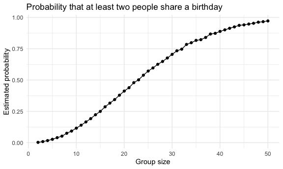

p8105_hw5_zg2582
================
Zaixin Gao
2026-11-18

``` r
library(tidyverse)

set.seed(1)

knitr::opts_chunk$set(
  fig.width = 6,
  fig.asp = .6,
  out.width = "90%"
)

theme_set(theme_minimal() + theme(legend.position = "bottom"))
```

# Problem 1

### Write birthday function

``` r
bday_sim = function(n) {
  birthdays = sample(1:365, size = n, replace = TRUE)
  repeated_bday = n_distinct(birthdays) < n
  repeated_bday
}
```

### Run it 10000 times for each group size between 2 and 50

``` r
bday_sim_df =
  expand_grid(group_size = 2:50,
    iter = 1:10000) |>
  mutate(shared_bday = map_lgl(group_size, bday_sim)) |>
  group_by(group_size) |>
  summarize(prob_shared = mean(shared_bday)
)
```

### Plot

``` r
bday_sim_df |>
  ggplot(aes(x = group_size, y = prob_shared)) +
  geom_point() +
  geom_line() +
  labs(
    title = "Probability that at least two people share a birthday",
    x = "Group size",
    y = "Estimated probability")
```



The probability of shared birthdays increases with group size. It is
near 0 for small groups, passes 50% at a group size of about 23, and is
close to 1 for a group of 50.

# Problem 2

### data frame of file names

``` r
study_df =
  tibble(file_name = list.files("./data")
  )
```

### Read every file

``` r
study_df =
  tibble(file_name = list.files("./data")
  ) |>
  mutate(file_path = str_c("./data/", file_name),
    data = map(file_path, read_csv)
  )
```
